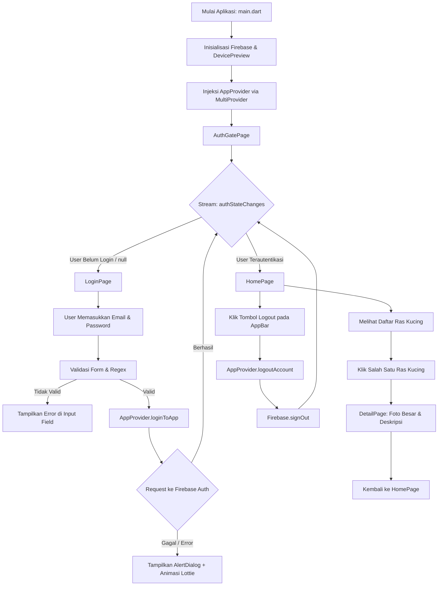

# 🐱 MCS Bab 3 - Aplikasi Katalog Ras Kucing & Autentikasi Firebase

Proyek ini adalah aplikasi mobile berbasis **Flutter** yang mengintegrasikan sistem autentikasi pengguna secara *real-time* menggunakan **Firebase Authentication**, manajemen status (*state management*) berbasis **Provider**, serta penyajian antarmuka katalog ras kucing interaktif dengan navigasi halaman detail.

Aplikasi ini dirancang dengan memisahkan *concern* (Separation of Concerns) secara rapi ke dalam beberapa lapisan arsitektural: *Model*, *Data*, *Provider*, *Screens*, *Services*, dan *Utils*.

---

## 📋 Daftar Isi
1. [Fitur Utama](#-fitur-utama)
2. [Teknologi & Dependensi](#-teknologi--dependensi)
3. [Struktur Direktori Proyek](#-struktur-direktori-proyek)
4. [Diagram Alur Aplikasi](#-diagram-alur-aplikasi)
5. [Penjelasan Rinci Kode Tiap File Dart](#-penjelasan-rinci-kode-tiap-file-dart)
   - [1. lib/main.dart](#1-libmaindart)
   - [2. lib/model/cat_model.dart](#2-libmodelcat_modeldart)
   - [3. lib/data/cat_data.dart](#3-libdatacat_datadart)
   - [4. lib/utils/app_style.dart](#4-libutilsapp_styledart)
   - [5. lib/services/firebase_options.dart](#5-libservicesfirebase_optionsdart)
   - [6. lib/provider/app_provider.dart](#6-libproviderapp_providerdart)
   - [7. lib/screens/auth_gate_page.dart](#7-libscreensauth_gate_pagedart)
   - [8. lib/screens/login_page.dart](#8-libscreenslogin_pagedart)
   - [9. lib/screens/home_page.dart](#9-libscreenshome_pagedart)
   - [10. lib/screens/detail_page.dart](#10-libscreensdetail_pagedart)
   - [11. test/widget_test.dart](#11-testwidget_testdart)
6. [Panduan Instalasi & Menjalankan Aplikasi](#-panduan-instalasi--menjalankan-aplikasi)
7. [Catatan Pembaruan & Keamanan](#-catatan-pembaruan--keamanan)

---

## ✨ Fitur Utama

- 🔐 **Autentikasi Firebase Terpusat**: Pengguna dapat masuk (*login*) menggunakan akun email & kata sandi yang divalidasi langsung oleh Firebase Authentication.
- 🔄 **Gerbang Autentikasi Reaktif (Auth Gate)**: Menggunakan `StreamBuilder` untuk mendengarkan perubahan status login pengguna (`authStateChanges`). Pengguna otomatis diarahkan ke `HomePage` saat berhasil login dan kembali ke `LoginPage` saat logout tanpa perlu navigasi manual yang rentan *bug*.
- 🛡️ **Validasi Formulir Ketat**: Pemeriksaan format email menggunakan Regular Expression (Regex) dan penanganan validasi password secara *real-time*.
- ⚠️ **Dialog Kesalahan Interaktif**: Menampilkan animasi Lottie (`assets/lottie_failed_animations.json`) di dalam *AlertDialog* jika autentikasi gagal.
- 🐈 **Katalog Ras Kucing**: Menampilkan daftar ras kucing dengan gambar mini (*thumbnail*) bersudut melengkung (`ClipRRect`), nama ras, dan tipografi modern via Google Fonts.
- 📄 **Halaman Detail Ras**: Menampilkan informasi komprehensif, foto resolusi penuh, dan deskripsi lengkap setiap ras kucing terpilih.
- 📱 **Device Preview Integration**: Mendukung pengujian tata letak responsif pada berbagai ukuran perangkat (Android, iOS, tablet, dsb.) secara dinamis selama mode pengembangan.

---

## 🛠️ Teknologi & Dependensi

Berdasarkan berkas `pubspec.yaml`, dependensi utama yang digunakan adalah:

| Paket / Plugin | Versi | Fungsi & Kegunaan |
| :--- | :--- | :--- |
| **`flutter`** | SDK | Kerangka kerja (*framework*) utama aplikasi |
| **`firebase_core`** | `^3.14.0` | Inisialisasi koneksi inti ke layanan Firebase |
| **`firebase_auth`** | `^5.6.0` | Mengelola autentikasi pengguna (login, logout, sesi pengguna) |
| **`provider`** | `^6.1.5` | Manajemen *state* terpusat berbasis pola *Observer* (`ChangeNotifier`) |
| **`google_fonts`** | `^9.0.0` | Menyediakan tipografi fleksibel (Roboto Flex, Oswald) tanpa *asset* lokal manual |
| **`lottie`** | `^3.3.1` | Merender animasi berbasis vektor JSON untuk pengalaman visual (*UX*) yang kaya |
| **`device_preview`** | `^1.3.1` | Simulator tampilan berbagai perangkat dalam satu layar selama pengujian |
| **`cupertino_icons`**| `^1.0.8` | Kumpulan ikon bergaya iOS |

---

## 📂 Struktur Direktori Proyek

```text
c:\Users\Mikazuki\Desktop\testbab3\
├── assets/
│   └── lottie_failed_animations.json   # Aset animasi JSON Lottie untuk dialog gagal login
├── lib/
│   ├── main.dart                       # Titik masuk utama aplikasi (Entry Point)
│   ├── data/
│   │   └── cat_data.dart               # Kumpulan data statis list ras kucing
│   ├── model/
│   │   └── cat_model.dart              # Model entitas representasi data kucing
│   ├── provider/
│   │   └── app_provider.dart           # State management & logika autentikasi Firebase
│   ├── screens/
│   │   ├── auth_gate_page.dart         # Pengatur alur login/home berbasis Stream
│   │   ├── login_page.dart             # Layar formulir autentikasi pengguna
│   │   ├── home_page.dart              # Layar beranda menampilkan daftar katalog kucing
│   │   └── detail_page.dart            # Layar detail informasi kucing terpilih
│   ├── services/
│   │   └── firebase_options.dart       # Konfigurasi platform Firebase otomatis (FlutterFire CLI)
│   └── utils/
│       └── app_style.dart              # Konstanta gaya visual, warna, dan tipografi
├── test/
│   └── widget_test.dart                # Pengujian widget dasar
└── pubspec.yaml                        # Konfigurasi proyek dan manajemen dependensi
```

---

## 🔄 Diagram Alur Aplikasi



---

## 🔍 Penjelasan Rinci Kode Tiap File Dart

Di bawah ini adalah penjelasan mendalam baris demi baris, fungsi, serta arsitektur kode dari seluruh file Dart yang ada pada proyek ini.

---

### 1. `lib/main.dart`

File `main.dart` merupakan titik masuk (*entry point*) pertama yang dieksekusi saat aplikasi dijalankan oleh *runtime* Flutter.

#### 📝 Cuplikan Kode Lengkap
```dart
import 'package:bab3/provider/app_provider.dart';
import 'package:bab3/screens/auth_gate_page.dart';
import 'package:bab3/services/firebase_options.dart';
import 'package:device_preview/device_preview.dart';
import 'package:firebase_core/firebase_core.dart';
import 'package:flutter/foundation.dart';
import 'package:flutter/material.dart';
import 'package:provider/provider.dart';

void main() async {
  WidgetsFlutterBinding.ensureInitialized();
  await Firebase.initializeApp(options: DefaultFirebaseOptions.currentPlatform);
  runApp(
    DevicePreview(enabled: !kReleaseMode, builder: (context) => const MyApp()),
  );
}

class MyApp extends StatelessWidget {
  const MyApp({super.key});

  @override
  Widget build(BuildContext context) {
    return MultiProvider(
      providers: [ChangeNotifierProvider(create: (context) => AppProvider())],
      child: MaterialApp(
        locale: DevicePreview.locale(context),
        builder: DevicePreview.appBuilder,
        title: "MCS BAB 2",
        debugShowCheckedModeBanner: false,
        theme: ThemeData(
          colorScheme: const ColorScheme.light(),
          useMaterial3: true,
        ),
        home: const AuthGatePage(),
      ),
    );
  }
}
```

#### 🔬 Analisis & Penjelasan Kode
1. **`void main() async`**: Fungsi utama dideklarasikan sebagai `async` karena aplikasi perlu menyelesaikan proses inisialisasi asynchronous (seperti koneksi ke Firebase) sebelum antarmuka pengguna dirender.
2. **`WidgetsFlutterBinding.ensureInitialized()`**: 
   - Menghubungkan engine Flutter dengan widget layer.
   - Wajib dipanggil sebelum mengeksekusi operasi asinkron native platform seperti `Firebase.initializeApp()`.
3. **`await Firebase.initializeApp(...)`**:
   - Menghubungkan aplikasi Flutter ke proyek Firebase menggunakan opsi konfigurasi spesifik platform dari `DefaultFirebaseOptions.currentPlatform`.
4. **`DevicePreview(enabled: !kReleaseMode, ...)`**:
   - Membungkus widget `MyApp` dengan `DevicePreview`.
   - `!kReleaseMode`: Fitur simulator perangkat ini hanya aktif pada saat *debug* atau *profile mode*, dan otomatis dinonaktifkan ketika aplikasi dikompilasi ke mode *release* untuk menjaga performa produksi.
5. **`MultiProvider` & `ChangeNotifierProvider`**:
   - Membungkus seluruh aplikasi dengan `MultiProvider`.
   - Mendaftarkan instance `AppProvider` di puncak pohon widget (*widget tree*), sehingga seluruh turunan widget dapat mengakses *state* dan metode autentikasi.
6. **`MaterialApp`**:
   - `locale: DevicePreview.locale(context)` dan `builder: DevicePreview.appBuilder`: Mengintegrasikan kalkulasi resolusi layar dan lokalisasi bahasa dari DevicePreview.
   - `useMaterial3: true`: Mengaktifkan pedoman visual Material Design 3 terbaru dari Google.
   - `home: const AuthGatePage()`: Menetapkan `AuthGatePage` sebagai halaman gerbang awal aplikasi untuk menentukan apakah pengguna harus melihat halaman Login atau Halaman Utama.

---

### 2. `lib/model/cat_model.dart`

File ini bertindak sebagai representasi data tunggal (*Data Model/Entity*) dalam pola arsitektur OOP (Object-Oriented Programming).

#### 📝 Cuplikan Kode Lengkap
```dart
class CatModel {
  String linkGambar;
  String namaKucing;
  String deskripsi;

  CatModel({
    required this.linkGambar,
    required this.namaKucing,
    required this.deskripsi
  });
}
```

#### 🔬 Analisis & Penjelasan Kode
1. **Atribut Kelas**:
   - `String linkGambar`: Menyimpan alamat URL publik gambar ras kucing yang akan dimuat via internet (`Image.network`).
   - `String namaKucing`: Menyimpan label nama ras kucing (misal: "Persia", "Ragdoll").
   - `String deskripsi`: Menyimpan uraian karakteristik dan penjelasan rinci mengenai ras kucing terkait.
2. **Konstruktor Bernama (`Named Constructor`)**:
   - Menggunakan parameter bernama (*named parameters*) dengan kata kunci `required`. Hal ini mencegah *null pointer exception* atau kesalahan kompilasi karena setiap objek `CatModel` wajib diinstansiasi dengan nilai yang lengkap dan valid.

---

### 3. `lib/data/cat_data.dart`

File ini berfungsi sebagai *Mock Data Source* atau penyedia data statis lokal sebelum data dihubungkan ke API/Database eksternal.

#### 📝 Cuplikan Kode Lengkap
```dart
import 'package:bab3/model/cat_model.dart';

List<CatModel> cats = [
  CatModel(
    linkGambar: "https://raw.githubusercontent.com/Fahmisbas/acsl-mcs/master/Bab%203%20-%20RecyclerView%20%26%20OnItemClickListener/cats/persia.jpg",
    namaKucing: "Persia",
    deskripsi: '''Persia merupakan jenis kucing dengan bulu panjang yang lebat dan wajah bulat yang menggemaskan. Mereka dikenal dengan sifat yang tenang, penyayang, dan cocok sebagai kucing peliharaan dalam ruangan.''',
  ),
  CatModel(
    linkGambar: "https://raw.githubusercontent.com/Fahmisbas/acsl-mcs/master/Bab%203%20-%20RecyclerView%20%26%20OnItemClickListener/cats/ragdoll.png",
    namaKucing: "Ragdoll",
    deskripsi: '''Ragdoll merupakan kucing besar dengan bulu panjang yang halus dan mata biru memikat. Mereka terkenal dengan kecenderungan mereka untuk rileks dan melonggar saat diangkat, mirip dengan boneka ragdoll, dan sangat penyayang.''',
  ),
  CatModel(
    linkGambar: "https://raw.githubusercontent.com/Fahmisbas/acsl-mcs/master/Bab%203%20-%20RecyclerView%20%26%20OnItemClickListener/cats/siam.jpeg",
    namaKucing: "Siam",
    deskripsi: '''Siam merupakan kucing dengan bulu pendek, mata biru tajam, dan tubuh yang ramping. Mereka dikenal sebagai kucing vokal yang suka berbicara dan memiliki kepribadian yang aktif serta ramah.''',
  ),
  CatModel(
    linkGambar: "https://raw.githubusercontent.com/Fahmisbas/acsl-mcs/master/Bab%203%20-%20RecyclerView%20%26%20OnItemClickListener/cats/sphynx.jpg",
    namaKucing: "Sphynx",
    deskripsi: '''Sphynx merupakan jenis kucing tanpa bulu yang memiliki kulit lembut seperti kulit jeruk. Mereka sering menjadi perhatian dengan penampilan yang unik dan ramah serta cerdas dalam perilaku mereka.''',
  ),
  CatModel(
    linkGambar: "https://raw.githubusercontent.com/Fahmisbas/acsl-mcs/master/Bab%203%20-%20RecyclerView%20%26%20OnItemClickListener/cats/maine%20coon.jpg",
    namaKucing: "Maine Coon",
    deskripsi: '''Maine Coon merupakan salah satu kucing terbesar dengan bulu panjang dan ekor berbulu tebal. Mereka memiliki sifat yang ramah, lembut, dan cenderung energik, serta memiliki fisik yang kuat.''',
  ),
  CatModel(
    linkGambar: "https://raw.githubusercontent.com/Fahmisbas/acsl-mcs/master/Bab%203%20-%20RecyclerView%20%26%20OnItemClickListener/cats/munchkin.jpg",
    namaKucing: "Munchkin",
    deskripsi: '''Munchkin merupakan jenis kucing dengan tubuh pendek dan kaki yang lebih pendek dari kucing biasa. Mereka memiliki penampilan unik yang lucu dan aktif dalam bermain.''',
  ),
  CatModel(
    linkGambar: "https://raw.githubusercontent.com/Fahmisbas/acsl-mcs/master/Bab%203%20-%20RecyclerView%20%26%20OnItemClickListener/cats/bengal.png",
    namaKucing: "Bengal",
    deskripsi: '''Bengal memiliki bulu yang berkilau dengan motif belang yang mirip macan tutul. Mereka aktif, cerdas, dan suka bermain, sering kali memiliki energi yang tinggi.''',
  ),
  CatModel(
    linkGambar: "https://raw.githubusercontent.com/Fahmisbas/acsl-mcs/master/Bab%203%20-%20RecyclerView%20%26%20OnItemClickListener/cats/britain%20shorthair.jpg",
    namaKucing: "Britain Shorthair",
    deskripsi: '''British Shorthair memiliki penampilan gemuk dengan wajah yang bulat dan mata besar. Mereka cenderung tenang, santai, dan mudah diurus, membuat mereka menjadi kucing peliharaan yang populer.''',
  ),
];
```

#### 🔬 Analisis & Penjelasan Kode
1. **Daftar Bertipe Kuat (`List<CatModel>`)**:
   - Variabel `cats` dideklarasikan sebagai list global yang memuat sekumpulan objek bertipe `CatModel`.
2. **Koleksi 8 Ras Kucing**:
   - Berisi data 8 jenis ras kucing populer: **Persia**, **Ragdoll**, **Siam**, **Sphynx**, **Maine Coon**, **Munchkin**, **Bengal**, dan **Britain Shorthair**.
3. **Multi-line String (`''' ... '''`)**:
   - Uraian deskripsi ditulis menggunakan sintaks *triple quotes* Dart agar dapat memuat paragraf multibaris tanpa memerlukan karakter *escape* `\n`, sehingga meningkatkan keterbacaan kode (*code readability*).

---

### 4. `lib/utils/app_style.dart`

File ini mengonsolidasikan seluruh konfigurasi desain visual, teks petunjuk (*hints*), palet warna, dan tipografi agar konsisten (*Design System Tokens*).

#### 📝 Cuplikan Kode Lengkap
```dart
import 'package:flutter/material.dart';
import 'package:google_fonts/google_fonts.dart';

class AppStyles {
  // TEKS DAN WARNA
  final String hintUsernameText = "Enter your mail";
  final String hintPassText = "Password";
  final String loginButtonText = "Login";
  final Color? backgroundColor = Colors.white;
  final Color? iconColor = Colors.grey[400];
  bool visibilityIcon = true;

  // GOOGLE FONTS
  final titleFontstyle = GoogleFonts.robotoFlex(
    fontSize: 17,
    color: Colors.black,
  );
  final hintTextFontStyle = GoogleFonts.oswald(
    fontSize: 14,
    color: Colors.grey[400],
  );
  final buttonFontStyle = GoogleFonts.oswald(
    fontSize: 14,
    color: Colors.white,
    fontWeight: FontWeight.bold,
  );
  final universalFontStyle = GoogleFonts.oswald(
    fontSize: 14,
    color: Colors.black,
  );
}
```

#### 🔬 Analisis & Penjelasan Kode
1. **Tujuan Sentralisasi Gaya**:
   - Menghindari *hardcoding* nilai visual secara berulang (*Don't Repeat Yourself - DRY*). Jika warna tema atau jenis font ingin diubah di masa depan, pengembang hanya perlu mengedit satu berkas ini.
2. **Properti Teks & Warna**:
   - `hintUsernameText` & `hintPassText`: Placeholder untuk kolom input form.
   - `backgroundColor` & `iconColor`: Warna dasar latar belakang dan aksen abu-abu untuk ikon formulir.
   - `visibilityIcon`: Flag status boolean yang digunakan untuk mengontrol keterlihatan teks kata sandi (*obscure text*).
3. **Google Fonts Style**:
   - `titleFontstyle`: Menggunakan `Roboto Flex` dengan ukuran 17 pt untuk judul AppBar.
   - `hintTextFontStyle`, `buttonFontStyle`, `universalFontStyle`: Menggunakan tipografi `Oswald` yang tegas dan modern dengan variasi bobot ketebalan (*weight*) dan ukuran font untuk tombol, label, dan *hint text*.

---

### 5. `lib/services/firebase_options.dart`

File ini dibuat secara otomatis oleh **FlutterFire CLI** untuk memetakan kredensial API Firebase sesuai dengan platform yang sedang menjalankan aplikasi.

#### 📝 Cuplikan Kode Lengkap
```dart
// File generated by FlutterFire CLI.
// ignore_for_file: type=lint
import 'package:firebase_core/firebase_core.dart' show FirebaseOptions;
import 'package:flutter/foundation.dart'
    show defaultTargetPlatform, kIsWeb, TargetPlatform;

class DefaultFirebaseOptions {
  static FirebaseOptions get currentPlatform {
    if (kIsWeb) {
      return web;
    }
    switch (defaultTargetPlatform) {
      case TargetPlatform.android:
        return android;
      case TargetPlatform.iOS:
        return ios;
      case TargetPlatform.macOS:
        return macos;
      case TargetPlatform.windows:
        return windows;
      case TargetPlatform.linux:
        throw UnsupportedError(
          'DefaultFirebaseOptions have not been configured for linux - '
          'you can reconfigure this by running the FlutterFire CLI again.',
        );
      default:
        throw UnsupportedError(
          'DefaultFirebaseOptions are not supported for this platform.',
        );
    }
  }

  static const FirebaseOptions web = FirebaseOptions(
    apiKey: '',
    appId: '',
    messagingSenderId: '',
    projectId: '',
    authDomain: '',
    storageBucket: '',
  );

  static const FirebaseOptions android = FirebaseOptions(
    apiKey: '',
    appId: '',
    messagingSenderId: '',
    projectId: '',
    storageBucket: '',
  );

  static const FirebaseOptions ios = FirebaseOptions(
    apiKey: '',
    appId: '',
    messagingSenderId: '',
    projectId: '',
    storageBucket: '',
    iosBundleId: '',
  );

  static const FirebaseOptions macos = FirebaseOptions(
    apiKey: '',
    appId: '',
    messagingSenderId: '',
    projectId: '',
    storageBucket: '',
    iosBundleId: '',
  );

  static const FirebaseOptions windows = FirebaseOptions(
    apiKey: '',
    appId: '',
    messagingSenderId: '',
    projectId: '',
    authDomain: '',
    storageBucket: '',
  );
}
```

#### 🔬 Analisis & Penjelasan Kode
1. **`DefaultFirebaseOptions.currentPlatform` Getter**:
   - Mendeteksi platform target saat aplikasi berjalan (`kIsWeb` untuk Web, `defaultTargetPlatform` untuk Android, iOS, Windows, macOS).
   - Mengembalikan konfigurasi konstanta `FirebaseOptions` yang sesuai dengan sistem operasi yang aktif.
2. **Sanitasi Kredensial Firebase (`apiKey`, `appId`, `projectId`, dll.)**:
   - Demi mematuhi praktik keamanan (*security best practices*), seluruh nilai konfigurasi kredensial sengaja dikosongkan (`''`) agar tidak mengekspos kredensial proyek Firebase ke publik/version control.
   - Pengembang dapat mengisi konfigurasi proyek masing-masing atau menggunakan FlutterFire CLI untuk mengonfigurasi otomatis.

---

### 6. `lib/provider/app_provider.dart`

File ini adalah jantung logika bisnis dan *state management* aplikasi, yang memperluas kelas `ChangeNotifier` dari paket Flutter Foundation.

#### 📝 Cuplikan Kode Lengkap
```dart
import 'package:firebase_auth/firebase_auth.dart';
import 'package:flutter/material.dart';

class AppProvider extends ChangeNotifier {
  final firebaseAuthentication = FirebaseAuth.instance;

  // METHOD LOGIN FIREBASE
  Future loginToApp(String username, String password) async {
    try {
      UserCredential userCredential = await firebaseAuthentication
          .signInWithEmailAndPassword(email: username, password: password);
      return userCredential;
    } catch (e) {
      throw Exception(e);
    }
  }

  // METHOD LOGOUT FIREBASE
  Future logoutAccount() async {
    await firebaseAuthentication.signOut();
  }
}
```

#### 🔬 Analisis & Penjelasan Kode
1. **`extends ChangeNotifier`**:
   - Memungkinkan kelas ini menjadi *Observable*. Setiap perubahan status di dalam provider ini dapat disiarkan kepada widget konsumen (*listener*) yang mendengarkannya.
2. **`firebaseAuthentication = FirebaseAuth.instance`**:
   - Menyimpan *singleton instance* dari `FirebaseAuth` untuk mengeksekusi operasi autentikasi dan mengakses stream status pengguna.
3. **`Future loginToApp(String username, String password) async`**:
   - Menerima `email` (disimpan pada variabel `username`) dan `password`.
   - Memanggil API `signInWithEmailAndPassword(...)`.
   - Mengembalikan objek `UserCredential` jika kredensial terverifikasi.
   - Blok `try-catch` menangkap setiap kegagalan login (misal kata sandi salah, akun tidak ditemukan, atau masalah jaringan) dan melempar kembali eksepsi menggunakan `throw Exception(e)` agar dapat ditangkap oleh UI (layar Login).
4. **`Future logoutAccount() async`**:
   - Memanggil `firebaseAuthentication.signOut()`.
   - Ketika proses logout selesai, Firebase secara otomatis memperbarui status stream `authStateChanges()`, memicu transisi UI ke halaman login secara reaktif.

---

### 7. `lib/screens/auth_gate_page.dart`

File ini berfungsi sebagai **penjaga gerbang navigasi utama** (*Authentication Gate*) yang secara dinamis beralih antara `LoginPage` dan `HomePage`.

#### 📝 Cuplikan Kode Lengkap
```dart
import 'package:bab3/provider/app_provider.dart';
import 'package:bab3/screens/home_page.dart';
import 'package:bab3/screens/login_page.dart';
import 'package:flutter/material.dart';
import 'package:provider/provider.dart';

class AuthGatePage extends StatelessWidget {
  const AuthGatePage({super.key});

  @override
  Widget build(BuildContext context) {
    return Consumer<AppProvider>(
      builder: (context, appProvider, child){
        return StreamBuilder(
          stream: appProvider.firebaseAuthentication.authStateChanges(),
          builder: (context, snapshot){
            if (snapshot.hasData){
              return HomePage();
            } else {
              return LoginPage();
            }
          },
        );
      },
    );
  }
}
```

#### 🔬 Analisis & Penjelasan Kode
1. **Pola Desain Reaktif Tanpa Routing Manual**:
   - Alih-alih melakukan `Navigator.pushReplacement` secara manual saat login atau logout berhasil, aplikasi menggunakan arsitektur berbasis *Event Stream*.
2. **`Consumer<AppProvider>`**:
   - Mendengarkan instance `AppProvider` yang disuplai oleh `MultiProvider`.
3. **`StreamBuilder` dengan `authStateChanges()`**:
   - `authStateChanges()` adalah stream dari Firebase yang memancarkan objek `User` saat pengguna login, dan memancarkan `null` saat pengguna logout.
4. **Logika Percabangan `snapshot.hasData`**:
   - **`if (snapshot.hasData)`**: Pengguna aktif terdeteksi -> Kembalikan `HomePage()`.
   - **`else`**: Pengguna belum login atau telah logout -> Kembalikan `LoginPage()`.

---

### 8. `lib/screens/login_page.dart`

File ini menangani antarmuka pengguna untuk autentikasi, validasi masukan form, penanganan kesalahan, dan umpan balik animasi Lottie.

#### 📝 Cuplikan Kode Lengkap
```dart
import 'package:bab3/provider/app_provider.dart';
import 'package:bab3/utils/app_style.dart';
import 'package:flutter/material.dart';
import 'package:lottie/lottie.dart';
import 'package:provider/provider.dart';

class LoginPage extends StatefulWidget {
  const LoginPage({super.key});

  @override
  State<LoginPage> createState() => _LoginPageState();
}

class _LoginPageState extends State<LoginPage> {
  final formKey = GlobalKey<FormState>();
  final usernameController = TextEditingController();
  final passController = TextEditingController();
  final appStyles = AppStyles();

  InputDecoration _inputDecoration(String hint, IconData icon, [Widget? suffix]) {
    final border = OutlineInputBorder(
      borderRadius: BorderRadius.circular(15),
      borderSide: const BorderSide(color: Colors.black),
    );
    return InputDecoration(
      hintText: hint,
      hintStyle: appStyles.hintTextFontStyle,
      prefixIcon: Icon(icon, color: appStyles.iconColor),
      suffixIcon: suffix,
      border: border,
      enabledBorder: border,
      focusedBorder: border,
    );
  }

  Future<void> validationForm() async {
    if (formKey.currentState?.validate() != true) return;

    try {
      await context.read<AppProvider>().loginToApp(
            usernameController.text,
            passController.text,
          );
    } catch (_) {
      if (!mounted) return;
      final size = MediaQuery.of(context).size.width / 6;
      showDialog<void>(
        context: context,
        builder: (_) => AlertDialog(
          title: Column(
            mainAxisSize: MainAxisSize.min,
            children: [
              const Text("Login Failed"),
              LottieBuilder.asset(
                "assets/lottie_failed_animations.json",
                width: size,
                height: size,
              ),
            ],
          ),
          content: const Text(
            "Silahkan Masukkan Username dan Password yang Benar",
            textAlign: TextAlign.center,
          ),
        ),
      );
    }
  }

  void resetForm() {
    usernameController.clear();
    passController.clear();
    formKey.currentState?.reset();
    setState(() {});
  }

  @override
  void dispose() {
    usernameController.dispose();
    passController.dispose();
    super.dispose();
  }

  @override
  Widget build(BuildContext context) {
    return Scaffold(
      backgroundColor: appStyles.backgroundColor,
      appBar: AppBar(
        backgroundColor: appStyles.backgroundColor,
        title: Text("Authentication Apps", style: appStyles.titleFontstyle),
        centerTitle: true,
      ),
      body: Padding(
        padding: const EdgeInsets.all(15),
        child: Column(
          mainAxisAlignment: MainAxisAlignment.center,
          children: [
            Container(
              padding: const EdgeInsets.all(15),
              decoration: BoxDecoration(
                border: Border.all(color: Colors.black),
                borderRadius: BorderRadius.circular(20),
                color: Colors.white,
                boxShadow: [
                  BoxShadow(
                    color: Colors.black.withValues(alpha: 0.3),
                    blurRadius: 7,
                    offset: const Offset(0, 15),
                  ),
                ],
              ),
              child: Form(
                key: formKey,
                child: Column(
                  mainAxisSize: MainAxisSize.min,
                  crossAxisAlignment: CrossAxisAlignment.start,
                  children: [
                    Text("Email", style: appStyles.universalFontStyle),
                    const SizedBox(height: 10),
                    TextFormField(
                      controller: usernameController,
                      keyboardType: TextInputType.emailAddress,
                      style: appStyles.universalFontStyle,
                      decoration: _inputDecoration(
                        appStyles.hintUsernameText,
                        Icons.mail_outline,
                      ),
                      autovalidateMode: AutovalidateMode.onUserInteraction,
                      validator: (value) {
                        if (value == null || value.isEmpty) {
                          return "Harap Isi Kolom username";
                        }
                        return RegExp(r'^[\w-\.]+@([\w-]+\.)+[\w-]{2,4}$')
                                .hasMatch(value)
                            ? null
                            : 'Harap masukkan E-MAIL sesuai dengan format';
                      },
                    ),
                    const SizedBox(height: 20),
                    Text("Password", style: appStyles.universalFontStyle),
                    TextFormField(
                      controller: passController,
                      obscureText: appStyles.visibilityIcon,
                      style: appStyles.universalFontStyle,
                      decoration: _inputDecoration(
                        appStyles.hintPassText,
                        Icons.lock_outline,
                        GestureDetector(
                          onTap: () => setState(
                            () => appStyles.visibilityIcon =
                                !appStyles.visibilityIcon,
                          ),
                          child: Icon(
                            appStyles.visibilityIcon
                                ? Icons.visibility_off
                                : Icons.visibility,
                            color: appStyles.iconColor,
                          ),
                        ),
                      ),
                      autovalidateMode: AutovalidateMode.onUnfocus,
                      validator: (value) => (value == null || value.isEmpty)
                          ? "Harap mengisikan kolom password"
                          : null,
                    ),
                    const SizedBox(height: 70),
                    Center(
                      child: GestureDetector(
                        onTap: validationForm,
                        child: Container(
                          padding: const EdgeInsets.symmetric(
                            horizontal: 40,
                            vertical: 10,
                          ),
                          decoration: BoxDecoration(
                            color: Colors.green[600],
                            borderRadius: BorderRadius.circular(10),
                          ),
                          child: Text(
                            appStyles.loginButtonText,
                            style: appStyles.buttonFontStyle,
                          ),
                        ),
                      ),
                    ),
                  ],
                ),
              ),
            ),
          ],
        ),
      ),
    );
  }
}
```

#### 🔬 Analisis & Penjelasan Kode
1. **Refactoring & Optimasi Efisiensi Kode**:
   - Kode disederhanakan dari sebelumnya 243 baris menjadi ~184 baris tanpa mengubah tampilan UI sama sekali.
   - **`_inputDecoration(...)` Helper**: Mengurangi duplikasi konfigurasi `OutlineInputBorder`, `hintText`, dan `prefixIcon` untuk kedua kolom input (Email dan Password).
   - Menghilangkan nesting *redundant* seperti `Padding` di dalam `Container` (menggunakan langsung properti `padding:` pada `Container`).
2. **Manajemen Kontroler & Lifecycle**:
   - `GlobalKey<FormState> formKey`: Mengidentifikasi widget `Form` secara unik untuk memicu fungsi validasi (`formKey.currentState?.validate()`).
   - `usernameController` & `passController`: Menyimpan dan mengamati nilai teks masukan dari pengguna.
   - `dispose()`: Melepaskan resource memori kontroler saat widget dihancurkan (*unmounted*) guna mencegah kebocoran memori (*memory leaks*).
3. **Metode `validationForm()` Ringkas**:
   - Memeriksa apakah seluruh field formulir telah memenuhi kriteria validasi dengan *guard clause* `if (formKey.currentState?.validate() != true) return;`.
   - Menggunakan `context.read<AppProvider>().loginToApp(...)` untuk memicu proses autentikasi Firebase.
   - **`if (!mounted) return;`**: Pengamanan *asynchronous gap* agar dialog tidak dipanggil jika widget sudah tidak aktif di layar.
   - **AlertDialog & Lottie**: Jika login gagal (blok `catch`), memunculkan dialog kesalahan beranimasi Lottie secara padat.
4. **Validasi Formulir Bersih**:
   - Validasi email regex dan validasi password disederhanakan dengan ekspresi ternary ringkas.
5. **Toggle Password Visibility & Tombol Login**:
   - `obscureText` langsung membaca nilai `appStyles.visibilityIcon`.
   - Tombol login kustom dengan latar belakang hijau (`Colors.green[600]`) diposisikan terpusat menggunakan `Center` di dalam struktur kolom tunggal.

---

### 9. `lib/screens/home_page.dart`

File ini menampilkan beranda utama aplikasi yang memuat katalog ras kucing dalam format daftar (*list*).

#### 📝 Cuplikan Kode Lengkap
```dart
import 'package:bab3/data/cat_data.dart';
import 'package:bab3/model/cat_model.dart';
import 'package:bab3/provider/app_provider.dart';
import 'package:bab3/screens/detail_page.dart';
import 'package:flutter/material.dart';
import 'package:google_fonts/google_fonts.dart';
import 'package:provider/provider.dart';

class HomePage extends StatefulWidget {
  const HomePage({super.key});

  @override
  State<HomePage> createState() => _HomePageState();
}

class _HomePageState extends State<HomePage> {
  @override
  Widget build(BuildContext context) {
    return Consumer<AppProvider>(
      builder: (context, appProvider, child) {
        return Scaffold(
          appBar: AppBar(
            title: const Text(
              "MCS BAB 2",
              style: TextStyle(color: Colors.black),
            ),
            centerTitle: true,
            backgroundColor: Colors.orange,

            // Tombol Logout
            actions: [
              IconButton(
                icon: Icon(Icons.logout, color: Colors.white),
                onPressed: () async {
                  await appProvider.logoutAccount();
                },
              ),
            ],
          ),
          body: ListView(
            children: [
              const SizedBox(height: 32),

              Center(
                child: Text(
                  "Jenis-Jenis Ras Kucing",
                  style: GoogleFonts.oswald(
                    fontSize: 16,
                    fontWeight: FontWeight.w600,
                  ),
                ),
              ),

              const SizedBox(height: 24),

              ListView.builder(
                itemCount: cats.length,
                shrinkWrap: true,
                physics: NeverScrollableScrollPhysics(),
                itemBuilder: (_, index) {
                  CatModel cat = cats[index];
                  return Container(
                    margin: EdgeInsets.symmetric(vertical: 12, horizontal: 18),
                    child: GestureDetector(
                      child: Row(
                        children: [
                          SizedBox(
                            height: MediaQuery.of(context).size.width / 4,
                            width: MediaQuery.of(context).size.width / 4,
                            child: ClipRRect(
                              borderRadius: BorderRadiusGeometry.circular(18),
                              child: Image.network(
                                cat.linkGambar,
                                fit: BoxFit.cover,
                              ),
                            ),
                          ),
                          const SizedBox(width: 14),
                          Text(
                            cat.namaKucing,
                            style: GoogleFonts.oswald(
                              fontSize: 16,
                              fontWeight: FontWeight.w600,
                            ),
                          ),
                        ],
                      ),
                      onTap: () {
                        Navigator.push(
                          context,
                          MaterialPageRoute(
                            builder: (context) {
                              return DetailPage(catModel: cat);
                            },
                          ),
                        );
                      },
                    ),
                  );
                },
              ),
            ],
          ),
        );
      },
    );
  }
}
```

#### 🔬 Analisis & Penjelasan Kode
1. **Aksi Logout pada AppBar**:
   - Bagian `actions` pada AppBar menyematkan `IconButton` dengan ikon `Icons.logout`.
   - Menjalankan `await appProvider.logoutAccount()` saat ditekan, yang langsung mengakhiri sesi Firebase dan memicu `AuthGatePage` untuk mengalihkan tampilan ke `LoginPage`.
2. **Struktur Bersarang `ListView` & `ListView.builder`**:
   - `ListView` utama berfungsi sebagai kontainer gulir vertikal halaman.
   - `ListView.builder`:
     - Digunakan untuk merender koleksi `cats` secara efisien (*lazy rendering*).
     - `shrinkWrap: true`: Menyesuaikan tinggi list builder dengan total konten anak.
     - `physics: NeverScrollableScrollPhysics()`: Mencegah konflik *scrolling* ganda antara list induk dan list anak.
3. **Item Katalog**:
   - `Image.network(cat.linkGambar, fit: BoxFit.cover)`: Memuat gambar ras kucing dari internet dan memastikan gambar memenuhi kontainer secara proporsional.
   - `ClipRRect(borderRadius: BorderRadius.circular(18), ...)`: Memotong sudut gambar agar memiliki efek membulat (*rounded card*) yang halus dan modern.
   - `Text(cat.namaKucing, ...)`: Menampilkan nama ras kucing dengan font Oswald semi-bold.
4. **Navigasi ke Halaman Detail**:
   - Setiap item dibungkus dengan `GestureDetector`.
   - Event `onTap` memanggil `Navigator.push` dengan `MaterialPageRoute` untuk berpindah ke `DetailPage`, sekaligus mengoper objek `catModel: cat` sebagai argumen data.

---

### 10. `lib/screens/detail_page.dart`

File ini menangani halaman detail yang menyajikan foto ras kucing dalam ukuran besar serta deskripsi lengkapnya.

#### 📝 Cuplikan Kode Lengkap
```dart
import 'package:bab3/model/cat_model.dart';
import 'package:flutter/material.dart';
import 'package:google_fonts/google_fonts.dart';

class DetailPage extends StatefulWidget {
  CatModel catModel;
  DetailPage({super.key, required this.catModel});

  @override
  State<DetailPage> createState() => _DetailPageState();
}

class _DetailPageState extends State<DetailPage> {
  @override
  Widget build(BuildContext context) {
    return Scaffold(
      appBar: AppBar(
        title: Text(
          widget.catModel.namaKucing,
          style: GoogleFonts.oswald(fontSize: 20, fontWeight: FontWeight.w600),
        ),
        centerTitle: true,
      ),
      body: ListView(
        children: [
          Image.network(widget.catModel.linkGambar),
          const SizedBox(height: 18),
          Container(
            margin: const EdgeInsets.symmetric(horizontal: 20),
            child: Text(
              widget.catModel.deskripsi,
              style: GoogleFonts.oswald(
                fontSize: 20,
                fontWeight: FontWeight.bold,
              ),
              textAlign: TextAlign.justify,
            ),
          ),
        ],
      ),
    );
  }
}
```

#### 🔬 Analisis & Penjelasan Kode
1. **Penerimaan Parameter Objek**:
   - `DetailPage` menerima parameter wajib `required this.catModel` bertipe `CatModel`.
   - Data ini dapat diakses di dalam `_DetailPageState` melalui properti `widget.catModel`.
2. **AppBar Dinamis**:
   - Judul AppBar menampilkan nama ras kucing yang sedang dilihat (`widget.catModel.namaKucing`) dengan gaya font Oswald ukuran 20 pt.
   - Tombol kembali (*back button*) otomatis disediakan oleh Flutter karena halaman ini dibuka menggunakan `Navigator.push`.
3. **Konten Deskripsi**:
   - `Image.network(widget.catModel.linkGambar)`: Menampilkan foto ras kucing dalam ukuran penuh.
   - `widget.catModel.deskripsi`: Ditampilkan dengan perataan rata kiri-kanan (`TextAlign.justify`) dan margin horizontal 20 px agar teks tampak rapi dan mudah dibaca di berbagai resolusi layar.

---

### 11. `test/widget_test.dart`

File ini adalah skrip pengujian bawaan (*smoke test*) untuk memverifikasi apakah widget awal aplikasi dapat terpasang dan berfungsi tanpa kegagalan kritis.

#### 📝 Cuplikan Kode Lengkap
```dart
import 'package:flutter/material.dart';
import 'package:flutter_test/flutter_test.dart';

import 'package:bab3/main.dart';

void main() {
  testWidgets('Counter increments smoke test', (WidgetTester tester) async {
    // Build our app and trigger a frame.
    await tester.pumpWidget(const MyApp());

    // Verify that our counter starts at 0.
    expect(find.text('0'), findsOneWidget);
    expect(find.text('1'), findsNothing);

    // Tap the '+' icon and trigger a frame.
    await tester.tap(find.byIcon(Icons.add));
    await tester.pump();

    // Verify that our counter has incremented.
    expect(find.text('0'), findsNothing);
    expect(find.text('1'), findsOneWidget);
  });
}
```

#### 🔬 Analisis & Penjelasan Kode
1. **`testWidgets(...)`**: Fungsi uji dari `flutter_test` yang menyediakan antarmuka virtual `WidgetTester` untuk berinteraksi dengan widget tanpa memerlukan emulator fisik.
2. **`tester.pumpWidget(...)`**: Membangun pohon widget aplikasi (`MyApp`) dan memicu proses rendering satu *frame*.
3. **`expect(...)` & Matcher**: Memeriksa keberadaan widget tertentu di layar (misalnya mencari teks tertentu dengan `find.text`).

---

## 🚀 Panduan Instalasi & Menjalankan Aplikasi

Berikut adalah langkah-langkah untuk mengunduh, mengonfigurasi, dan menjalankan proyek ini di lingkungan lokal Anda:

### 1. Prasyarat Sistem
- **Flutter SDK**: Versi `^3.13.5` atau yang lebih baru.
- **Dart SDK**: Terpasang bersama dengan Flutter.
- **Android Studio / VS Code**: Lengkap dengan ekstensi Flutter & Dart.
- **Perangkat Fisik / Emulator**: Android, iOS simulator, atau browser Chrome.

### 2. Kloning Repositori
```bash
git clone https://github.com/Mikazuki54/MCS_BAB3.git
cd MCS_BAB3
```

### 3. Mengunduh Dependensi
Jalankan perintah berikut untuk mengunduh seluruh dependensi yang tertera pada `pubspec.yaml`:
```bash
flutter pub get
```

### 4. Konfigurasi Aset
Pastikan file animasi Lottie `assets/lottie_failed_animations.json` sudah tersedia di direktori proyek sesuai dengan deklarasi pada `pubspec.yaml`:
```yaml
flutter:
  assets:
    - assets/
```

### 5. Konfigurasi Kredensial Firebase
Demi keamanan, kredensial pada `lib/services/firebase_options.dart` telah dikosongkan dan `firebase.json` diabaikan oleh Git. Anda dapat menghubungkan proyek Firebase Anda dengan menjalankan perintah:
```bash
flutterfire configure
```
Atau masukkan kredensial proyek Firebase Anda secara manual ke dalam variabel konstanta platform pada `lib/services/firebase_options.dart`.

### 6. Menjalankan Aplikasi
Jalankan aplikasi di perangkat atau emulator pilihan Anda:
```bash
flutter run
```

---

## 🔒 Catatan Pembaruan & Keamanan

Berikut adalah ringkasan pembaruan dan optimasi terbaru yang diterapkan pada repositori:

1. **Sanitasi Kredensial Firebase (`firebase_options.dart`)**:
   - Seluruh nilai konfigurasi platform (`apiKey`, `appId`, `messagingSenderId`, `projectId`, `authDomain`, `storageBucket`, dan `iosBundleId`) untuk Web, Android, iOS, macOS, dan Windows telah dikosongkan demi melindungi privasi akun dan keamanan proyek Firebase.

2. **Perlindungan Berkas Konfigurasi (`.gitignore` & `firebase.json`)**:
   - Berkas `firebase.json` telah didaftarkan ke dalam `.gitignore` dan dilepas dari pelacakan indeks Git (`git rm --cached`) untuk mencegah kebocoran informasi proyek saat melakukan *commit* atau *push* ke repositori publik.

3. **Refactoring & Optimasi Halaman Login (`lib/screens/login_page.dart`)**:
   - **Pemendekan Kode**: Ukuran kode berhasil dipangkas dari 243 baris menjadi ~184 baris (pengurangan ~25%) tanpa mengubah tampilan maupun interaksi pengguna.
   - **Deduplikasi Dekorasi Input**: Menambahkan helper `_inputDecoration(...)` untuk memusatkan konfigurasi `OutlineInputBorder`, gaya hint, dan warna ikon sehingga tidak berulang di setiap kolom.
   - **Perataan Struktur Widget**: Menghapus `Padding` redundant di dalam `Container` yang sudah memiliki properti `padding:` serta merapikan hierarki `Column` dan `Form`.
   - **Validasi Lebih Padat**: Menyederhanakan penulisan ekspresi Regex email dan validasi kolom teks menjadi lebih ringkas dan bersih.
   - **Pembersihan Kondisi**: Menghapus ekspresi ternary berlebih pada toggle `obscureText`.

---

## 👨‍💻 Penulis & Lisensi

- **Mata Kuliah**: Mobile Computing Studies (MCS)
- **Topik**: Autentikasi Pengguna Firebase, Manajemen State Provider, dan Integrasi List Katalog Interaktif
- **Lisensi**: Proyek ini dikembangkan untuk kebutuhan edukasi dan akademik.
